# Animated Weather Card

A [Home Assistant](https://www.home-assistant.io/) Lovelace card that shows your weather on a **live animated sky**: sun with rays and lens flares, moon and stars (with shooting stars), layered clouds, rain with drops running down the glass, snow, thunderstorm with lightning flashes, fog and wind. The sky follows the weather entity **and** the real sun position, so it blends from day through dusk to night by itself.

One JavaScript file, no dependencies, no external services (fonts are optional, see below).

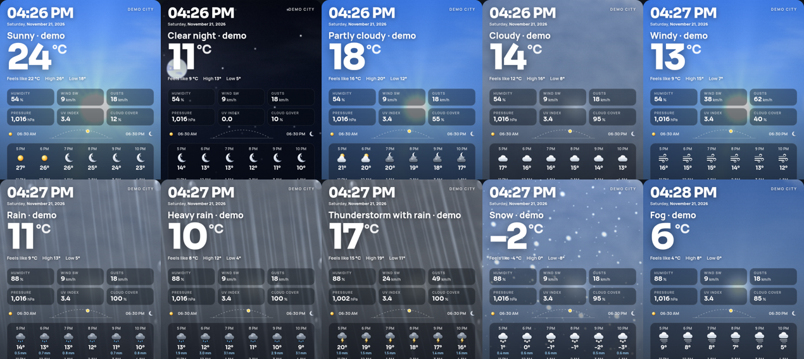

## Features

- Animated WebGL sky: clear, partly cloudy, cloudy, rain, heavy rain, snow, sleet, thunderstorm, fog, wind, hail, clear night (day / dusk / night / morning light)
- Current conditions, feels-like, details (humidity, wind, gusts, pressure, UV index, cloud cover)
- Sunrise / sunset arc, hourly strip, 24 h temperature + precipitation graph, daily forecast
- Units come straight from your Home Assistant weather entity (°C / °F, km/h / mph / m/s, hPa / inHg, mm / in)
- Languages: English, Slovak, Czech, German (`locale: auto` follows your Home Assistant language); dates and numbers use your locale
- Visual editor, demo mode, works in masonry, sections and panel views, scales from phone to wall tablet
- Light on resources: renders at reduced resolution, pauses when the tab is hidden, can be switched to a static gradient

## Installation

### HACS (recommended)

1. HACS -> three dots -> **Custom repositories** -> add `https://github.com/Marco520520/ha-animated-weather-card`, category **Dashboard** (Lovelace / Plugin).
2. Install **Animated Weather Card** and reload the browser.

### Manual

1. Download `dist/ha-animated-weather-card.js` and copy it to `<config>/www/`.
2. Settings -> Dashboards -> three dots -> **Resources** -> add `/local/ha-animated-weather-card.js` as **JavaScript module**.
3. Hard-refresh the browser.

## Usage

Add a card (it appears in the card picker as *Animated Weather Card*) or use YAML. The only thing you must set is your weather entity, i.e. **your location**:

```yaml
type: custom:ha-animated-weather-card
weather_entity: weather.home
```

Any `weather.*` entity works (Met.no, OpenWeatherMap, Open-Meteo, AccuWeather, ...). To change the location, point the card at another weather entity, or create one in Settings -> Devices & services -> Add integration -> *Meteorologisk institutt (Met.no)* / *Open-Meteo* for any place you like.

### Full example

```yaml
type: custom:ha-animated-weather-card
weather_entity: weather.home
name: Vienna                  # label in the corner
locale: auto                  # auto | en | sk | cs | de
hour12: null                  # null = by locale, true / false to force
mode: auto                    # auto | day | night
show_clock: true
show_details: true
show_sun: true
show_hourly: true
show_graph: true
show_daily: true
hours: 12
days: 5
border_radius: 24
height: 520px                 # optional, default fits the content
footer: Data: Met.no          # optional footer text
chips:                        # optional extra sensors under the temperature
  - entity: sensor.living_room_temperature
    label: Indoor
    unit: °C
    decimals: 1
```

### Options

| Option | Default | Description |
| --- | --- | --- |
| `weather_entity` | **required** | The `weather.*` entity (current state + hourly forecast). This is your location. |
| `daily_entity` | - | Another `weather.*` entity used for the daily strip if the main one gives few days. |
| `details_entity` | - | Another `weather.*` entity providing `uv_index`, `cloud_coverage`, `wind_gust_speed` when the main one lacks them. |
| `feels_like_entity` | - | Another `weather.*` entity with `apparent_temperature` in its hourly forecast (e.g. Open-Meteo). |
| `sun_entity` | `sun.sun` | Sun entity (elevation / azimuth / sunrise / sunset drive the sky). |
| `name` | - | Location label in the header. |
| `footer` | - | Free text in the footer (e.g. data source). |
| `locale` | `auto` | `auto`, `en`, `sk`, `cs`, `de`. |
| `hour12` | `null` | Force 12 h (`true`) or 24 h (`false`) clock. |
| `mode` | `auto` | Force the sky: `day` or `night`. |
| `animated` | `true` | `false` = static gradient instead of the WebGL sky. |
| `show_clock` / `show_details` / `show_sun` / `show_hourly` / `show_graph` / `show_daily` | `true` | Show or hide sections. |
| `hours` / `days` | `12` / `5` | Items in the hourly / daily strips. |
| `chips` | `[]` | Extra values: `entity`, `label`, `unit`, `decimals`. |
| `border_radius` | `24` | Corner radius in px. |
| `height` | content | CSS height, e.g. `520px`. |
| `quality` | `0.45` | Sky resolution (share of pixels, `0.2`-`1`). Raise on a fast device. |
| `fps` | `30` | Sky frame rate. |
| `refresh_min` | `15` | Forecast refresh interval in minutes. |
| `load_fonts` | `true` | Load Manrope + Sora from Google Fonts. `false` = system fonts and no external request. |
| `demo` | - | See below. |

### Demo mode

Set `demo` to preview a sky with built-in sample data, no matter what the weather really is (handy for choosing a look or testing):

```yaml
type: custom:ha-animated-weather-card
demo: storm            # rain | pouring | snow | storm | fog | clear | night | cloudy | partly | windy | hail | sleet
```

Add `-night` to force night (`rain-night`). You can also append `?demo=snow` to any dashboard URL, and a standalone preview that needs no Home Assistant is in [`demo/index.html`](demo/index.html) (open it through any static web server, e.g. `python3 -m http.server`, then `http://localhost:8000/demo/`).

## Screenshots

Three card variants running in a real Home Assistant dashboard (full, compact with 12 h clock, and static gradient with system fonts):

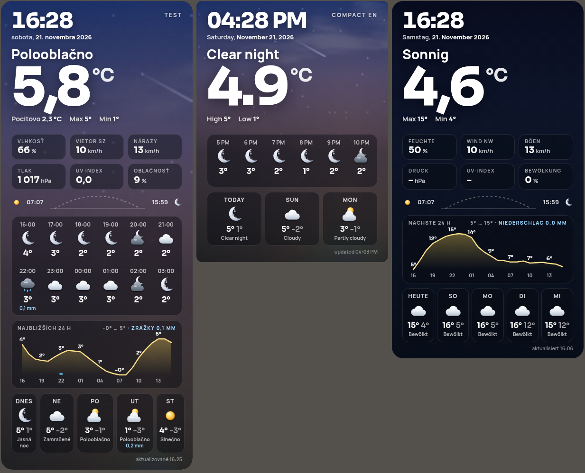

Every state from the demo mode:

| Clear | Night | Partly cloudy | Cloudy | Windy |
| --- | --- | --- | --- | --- |
| 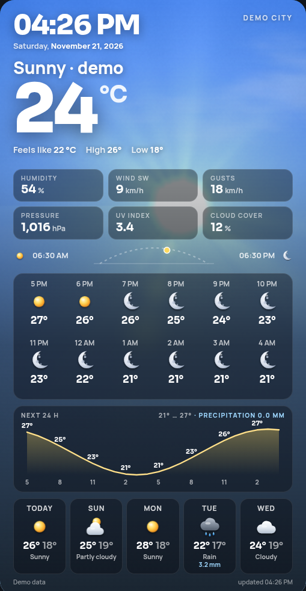 | 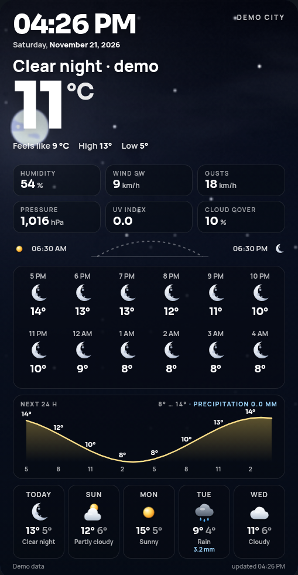 | 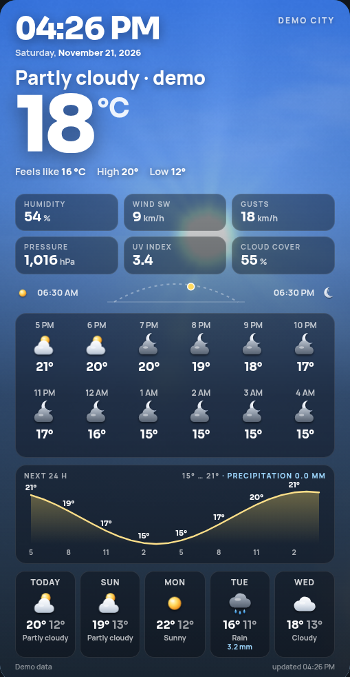 | 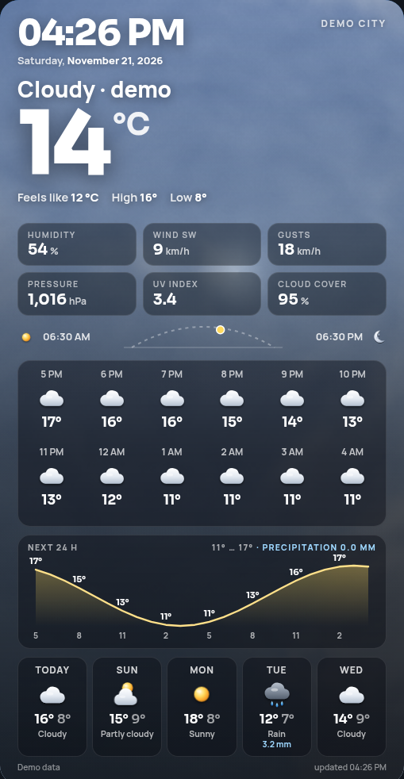 | 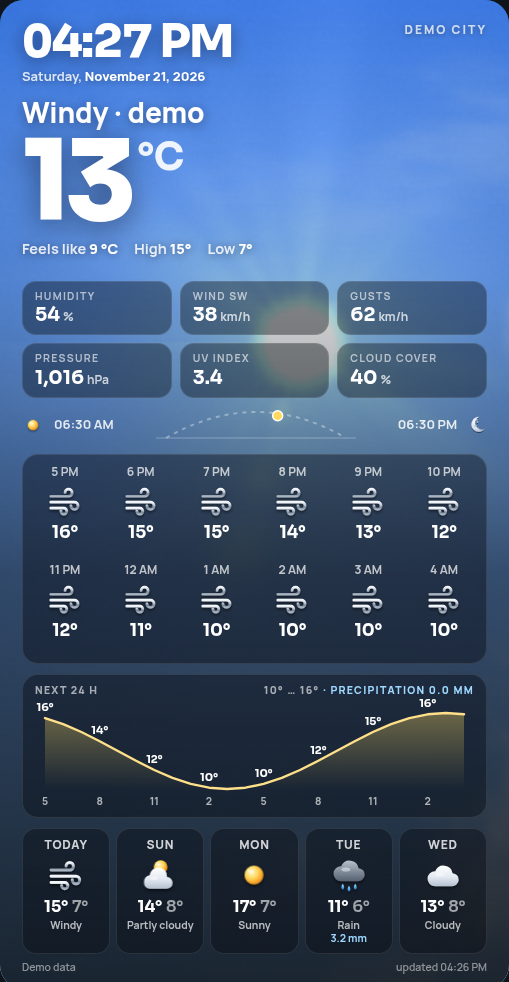 |

| Rain | Heavy rain | Thunderstorm | Snow | Fog |
| --- | --- | --- | --- | --- |
| 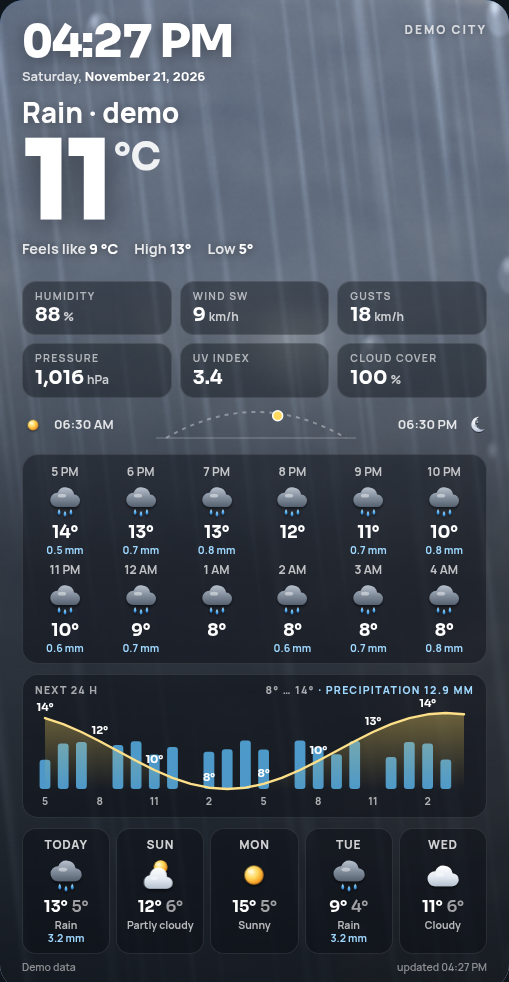 | 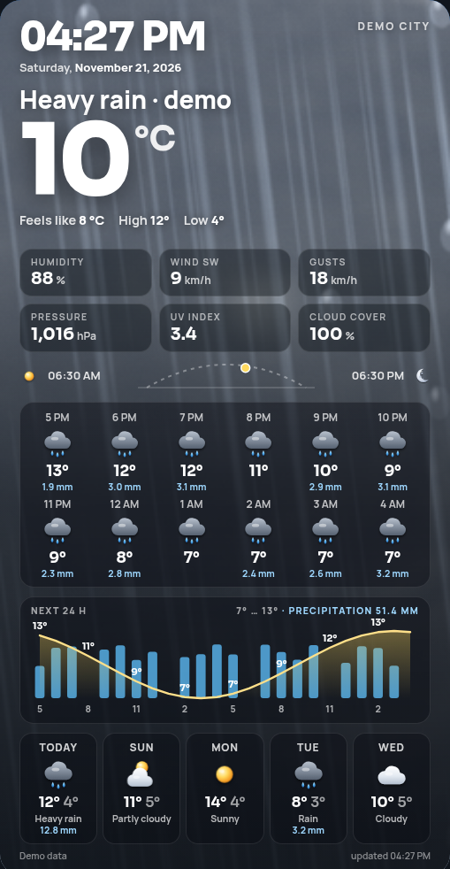 | 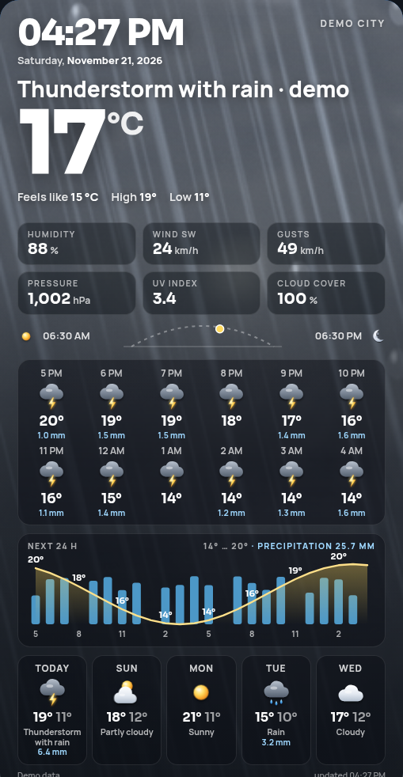 | 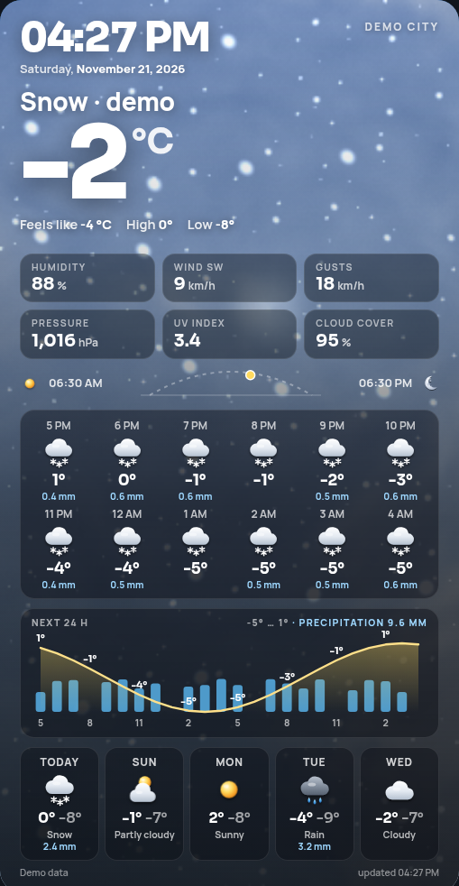 | 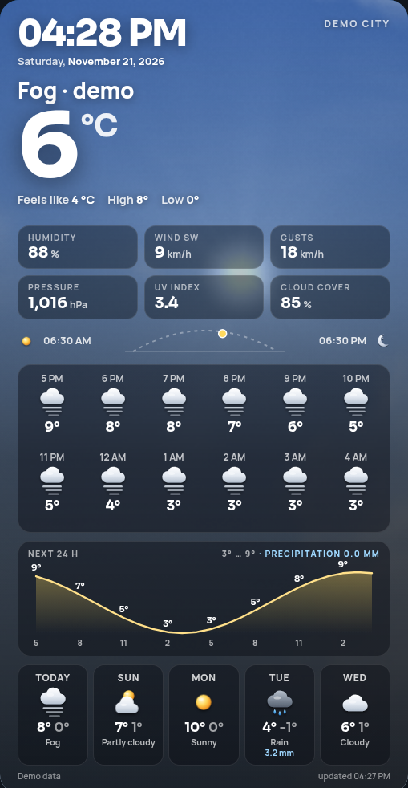 |

All screenshots come from the demo mode (`scripts/screenshots.js` regenerates them).

## Notes

- Needs WebGL (every current browser, the Home Assistant Companion apps and most wall-tablet browsers). Without WebGL the card falls back to a plain gradient.
- Forecasts are read with the `weather.get_forecasts` service (Home Assistant 2024.3 or newer).
- Privacy: the only external request is the optional Google Fonts stylesheet. Set `load_fonts: false` to avoid it.
- Prefers-reduced-motion is respected for the spinning sun icons; set `animated: false` to turn the sky animation off completely.

## Customising

Everything lives in one readable file, [`dist/ha-animated-weather-card.js`](dist/ha-animated-weather-card.js): the GLSL sky shader at the top, then the card styles (`CSS`), the icons (`S`), the translations (`I18N`) and the card class. Colours of the sky are the `skyCol` function in the shader; to add a language copy an entry in `I18N`. Pull requests welcome. To enable automatic HACS validation in your fork, copy [`docs/validate-workflow.example.yml`](docs/validate-workflow.example.yml) to `.github/workflows/validate.yml`.

## License

[MIT](LICENSE)
